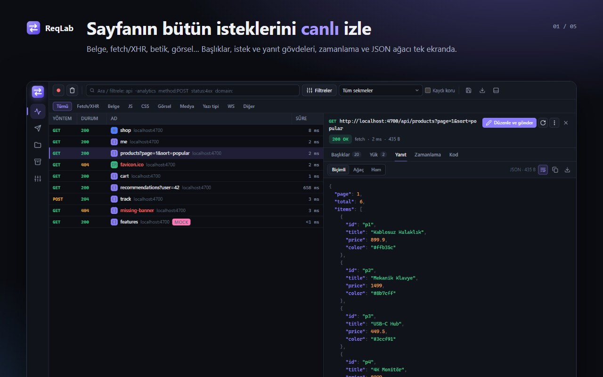
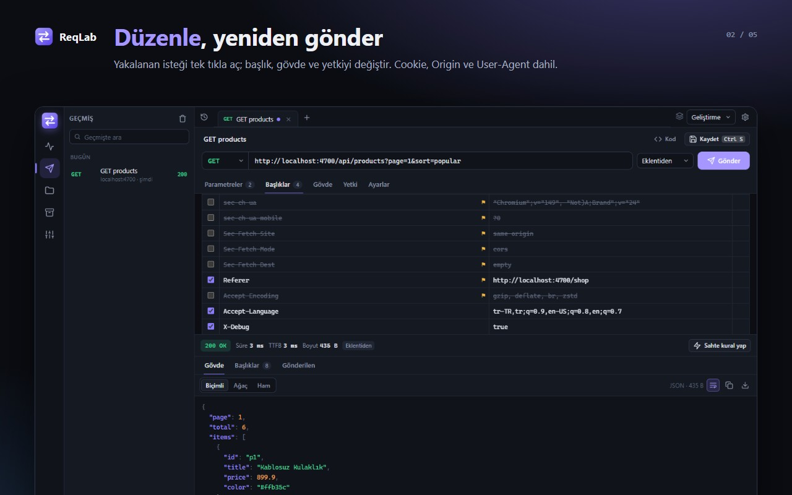
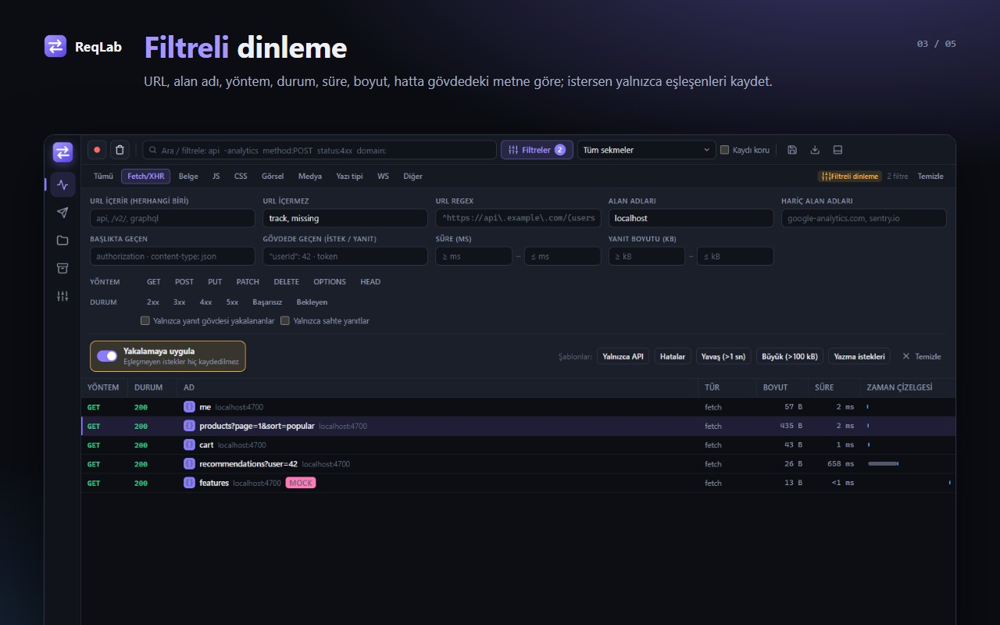
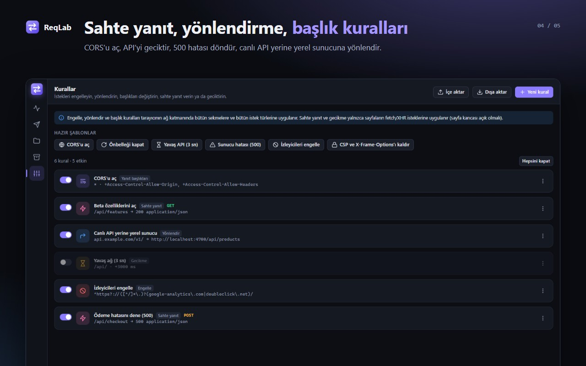
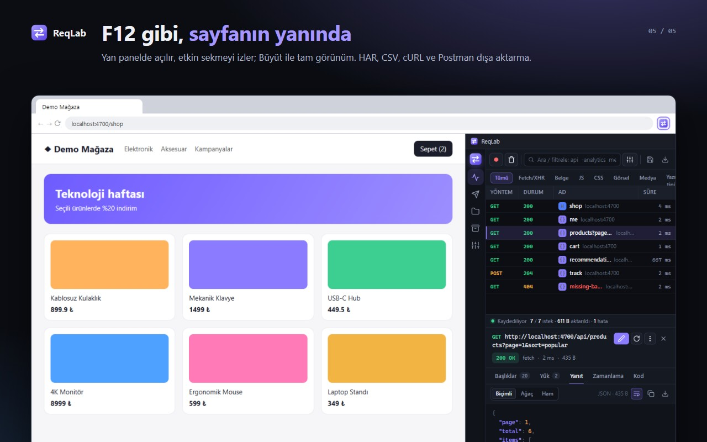
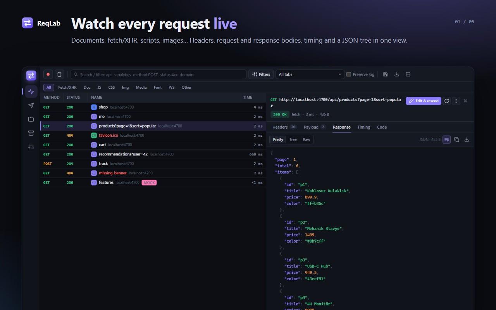
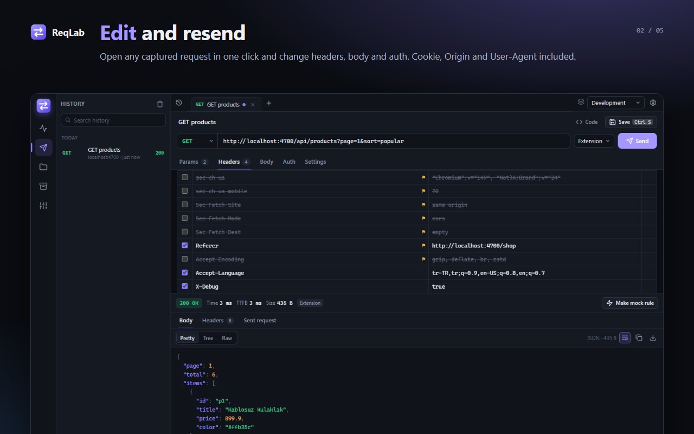
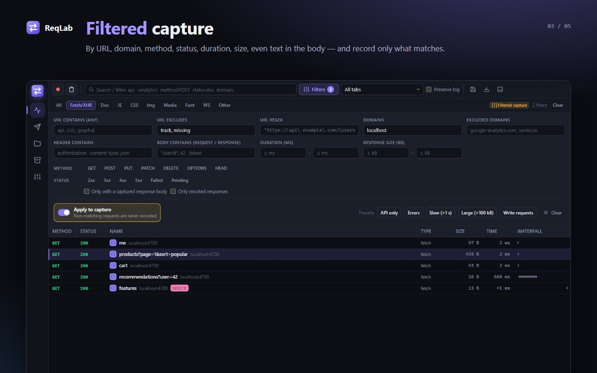
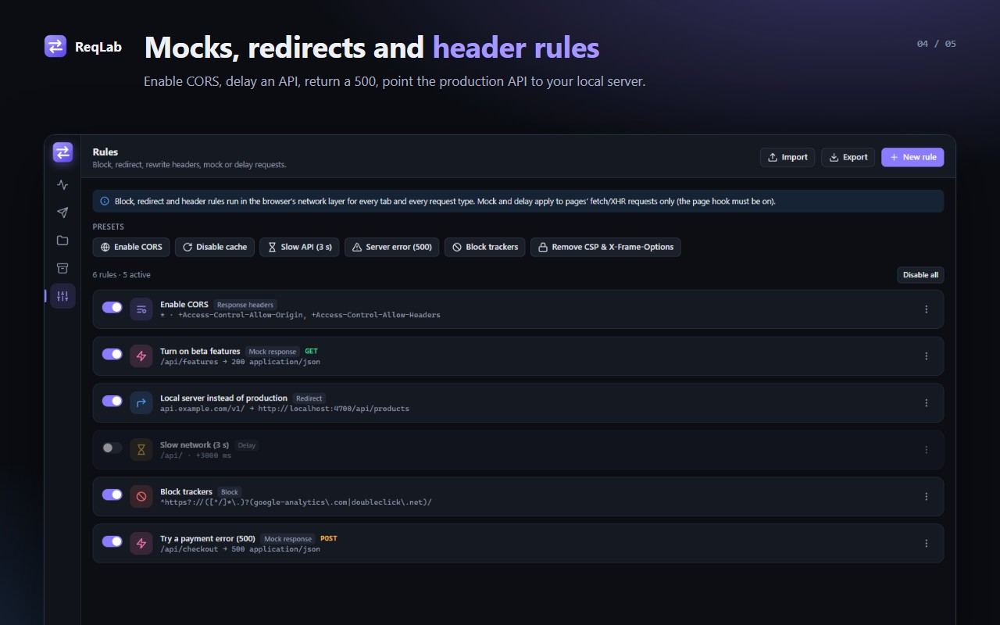
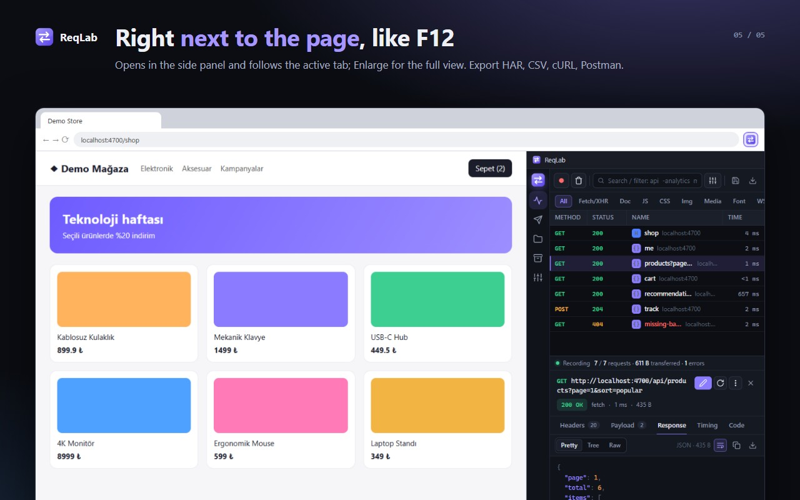

<div align="center">


# ReqLab

**İstek Denetleyici ve API İstemcisi · Request Inspector & API Client**




</div>

Sayfanın gönderdiği her isteği yakalayan, düzenleyip yeniden gönderebildiğin, REST API'leri test edebildiğin, sahte yanıt verip başlıkları değiştirebildiğin bir Chrome eklentisi. Yazılımcılar için.

_A Chrome extension that captures every request a page makes, lets you edit and resend them, test REST APIs, mock responses and rewrite headers. Built for developers._

## Özellikler · Features

### Ağ · Network
- Bütün istekler: belge, fetch/XHR, JS, CSS, görsel, yazı tipi, medya, WebSocket… (webRequest).
- fetch/XHR **istek ve yanıt gövdeleri** sayfa kancasıyla yakalanır (sayfa açılışındaki ilk istekler dahil).
- Hızlı arama ifadeleri: `api -analytics method:POST status:4xx domain:example.com type:xhr is:error is:mock`; tür çipleri (Ctrl/Shift ile çoklu), sekmeye göre süzme, "kaydı koru".
- **Ayrıntılı filtre paneli:** URL içerir/hariç, regex, alan adı dahil/hariç, yöntem, durum (2xx…5xx, başarısız, bekleyen), süre ve boyut aralığı, başlıkta ve **istek/yanıt gövdesinde metin**, yalnızca gövdesi olanlar / sahte yanıtlar. Şablonlar: yalnızca API, hatalar, yavaş, büyük, yazma istekleri.
- **Filtreli dinleme:** "Yakalamaya uygula" açıkken eşleşmeyen istekler hiç kaydedilmez (URL/yöntem/tür istek başlarken, durum/süre/boyut/gövde istek bitince değerlendirilir).
- Ayrıntı: başlıklar, sorgu/form/gövde, yanıt (biçimli · JSON ağacı · ham · önizleme), zamanlama, kod (cURL, fetch, Python, HTTPie).
- Sanal liste: binlerce istekte akıcı.
- Çoklu seçim: `Ctrl`/`Shift` + tık, `Ctrl+A`; seçilenleri sakla ya da dışa aktar.
- Sağ tık: düzenle ve gönder, aynen tekrar gönder, cURL/fetch kopyala, koleksiyona kaydet, bu yanıttan sahte kural, engelle, geciktir.

### Kayıtlar ve dışa aktarma · Recordings & export
- Yakalanan istekleri (seçilen / görünen / tümü) **adlandırılmış kayıt** olarak sakla; gövdelerle ya da gövdesiz. Kayıtlar tarayıcıyı kapatsan da kalır.
- Kaydı sonradan Ağ ekranında aç: filtrele, incele, düzenleyip yeniden gönder. Canlı trafik kayıt görünümünü bozmaz.
- Dışa aktarma biçimleri: **HAR** (DevTools, Postman, Charles, Fiddler), **ReqLab JSON** (geri içe aktarılır), **CSV** (Excel/Sheets), **cURL betiği** (.sh), **Postman koleksiyonu** (v2.1).
- **HAR / ReqLab JSON içe aktarma:** başka bir tarayıcıdan ya da DevTools’tan alınmış HAR dosyaları kayıt olarak açılır.

### İstemci · Client
- Postman benzeri sekmeler; parametre ↔ URL eşitleme, başlıklar (toplu düzenleme), gövde (JSON doğrulama/biçimlendirme, metin, x-www-form-urlencoded, form-data), yetki (Bearer, Basic, API key).
- **Ortam değişkenleri:** `{{baseUrl}}`, `{{token}}`…
- İki gönderim yolu:
  - **Eklentiden:** CORS engeli yok; tarayıcının normalde yasakladığı `Cookie`, `Origin`, `Referer`, `User-Agent` başlıkları yalnızca o istek için geçici bir ağ kuralıyla ayarlanır.
  - **Sayfa içinden:** isteği seçilen sekmede sayfanın kendisi yapmış gibi gönderir (kökeni, çerezleri, CORS kuralları).
- Yanıt: durum, süre, TTFB, boyut, başlıklar, gönderilen istek özeti; yanıttan tek tıkla sahte kural.
- Geçmiş, kod parçası, URL alanına cURL yapıştırınca otomatik içe aktarma. `Ctrl+Enter` gönder, `Ctrl+S` kaydet.

### Koleksiyonlar · Collections
- Kayıtlı istekler; yeniden adlandır, çoğalt, taşı, sil.
- İçe aktar: **ReqLab JSON, Postman v2 koleksiyonu, HAR, cURL** (bir veya birden çok). Dışa aktar: JSON.

### Kurallar · Rules
| Kural | Nasıl çalışır |
|---|---|
| Engelle · Block | Tarayıcı ağ kuralı, bütün istek türleri |
| Yönlendir · Redirect | Tarayıcı ağ kuralı (düzenli ifadede `\1` grupları) |
| İstek başlıkları · Request headers | Ayarla / kaldır (Cookie, Origin, User-Agent dahil) |
| Yanıt başlıkları · Response headers | Ayarla / kaldır / ekle (CORS açma, CSP kaldırma) |
| Sahte yanıt · Mock | Sayfa kancası; fetch ve XHR, durum + başlık + gövde + gecikme |
| Gecikme · Delay | Sayfa kancası; fetch ve XHR |

Hazır şablonlar: CORS'u aç, önbelleği kapat, yavaş API, 500 hatası, izleyicileri engelle, CSP'yi kaldır. Bir URL ile "dene" alanı, içe/dışa aktarma.

### Diğer · Other
- **Yan panel (varsayılan, F12 gibi):** simgeye tıklayınca ya da `Ctrl+Shift+Y` ile ReqLab sayfanın yanında, aynı pencerede açılır; etkin sekmeyi izler. Dar alana uygun düzen; genişliği panel kenarından sürükleyerek ayarlanır. **Büyüt** düğmesi tam görünümü sayfanın yanındaki sekmede açar ve yakalanan istekleri de taşır.
- Sekme modunda: **bulunduğun sekmenin yanında açılır** ve listeyi otomatik olarak o sekmenin istekleriyle sınırlar; zaten açıksa o sekmenin yanına taşınır.
- **Açılış biçimi:** sekmede, ayrı uygulama penceresinde (adres çubuğu olmadan) ya da doğrudan tam ekran. Ayarlardan seçilir; simgeye sağ tıklayıp o an da seçilebilir. Zaten açıksa yeni kopya açılmaz, öne gelir.
- **Tam ekran:** sol menüdeki düğme ya da `Ctrl+Shift+F` (çıkış: aynı düğme / `Esc`).
- **DevTools paneli:** Geliştirici araçlarında "ReqLab" sekmesi; incelenen sekmeye kilitli. Panelden tek tıkla tam uygulamaya geçilir.
- Koyu / açık / sistem teması, Türkçe / İngilizce.
- Yedekle / geri yükle (koleksiyonlar, kayıtlar, ortamlar, kurallar, geçmiş, ayarlar).
- **Hiçbir veri dışarı gönderilmez:** yakalanan istekler yalnızca açık pencerede, kayıtlar yalnızca bu tarayıcıda durur.

## Ekran görüntüleri · Screenshots

<p align="center">




</p>

<details><summary>English screenshots</summary>

<p align="center">





</p>
</details>

## Kurulum · Install

1. `chrome://extensions` → **Geliştirici modu / Developer mode** açık.
2. **Paketlenmemiş öğe yükle / Load unpacked** → `reqlab-extension` klasörü.
3. Simgeye tıkla ya da `Ctrl+Shift+Y`ye bas: yan panelde açılır (`Alt+Shift+L` = simgeye tıklamak) (sağ tık: yan panel / sekme / ayrı pencere / tam ekran). Eklenti kurulmadan önce açık olan sekmeleri bir kez yenile (yanıt gövdeleri için).

## Sınırlar · Limits

- Tarayıcı, belge/betik/görsel gibi isteklerin **yanıt gövdesini** eklentilere vermez; bunlar için "Yanıtı getir" GET'i yeniden ister. fetch/XHR gövdeleri doğrudan yakalanır.
- Ayrıntılı DNS/TCP/TLS süreleri eklentilere açık değildir; zamanlama kuyruk, bekleme (TTFB) ve indirme olarak gösterilir.
- Set-Cookie yanıt başlıkları tarayıcı tarafından gizlenir.
- form-data gönderiminde yalnızca metin alanları desteklenir.

## Yapı · Structure

```
manifest.json
background.js          Uygulama sekmesi, sayfa kancası kaydı, ağ kuralları (DNR), istek gönderme
content/bridge.js      İzole dünya: kanca ↔ eklenti köprüsü
content/hook.js        Sayfa dünyası: fetch/XHR sarmalayıcı (gövdeler, sahte yanıt, gecikme)
devtools/              DevTools paneli
app/                   Uygulama (Ağ, İstemci, Koleksiyonlar, Kurallar, Ayarlar)
  js/capture.js        webRequest + kanca birleştirme, HAR
  js/network.js        Ağ görünümü          js/client.js       İstemci
  js/collections.js    Koleksiyonlar        js/rules.js        Kurallar
  js/filters.js        Ayrıntılı filtre ve filtreli yakalama
  js/recordings.js     Kayıtlar; HAR/JSON/CSV/cURL/Postman dışa, HAR/JSON içe aktarma
  js/spec.js           İstek modeli         js/codegen.js      cURL/fetch/Python/HTTPie, cURL ayrıştırıcı
  js/viewer.js         Gövde görüntüleyici  js/kv.js           Anahtar/değer tablosu
```

## Gizlilik · Privacy

ReqLab hiçbir veriyi dışarı göndermez. Ayrıntılar: [PRIVACY.md](PRIVACY.md) · [web sayfası](https://emrebayrakk.github.io/reqlab/privacy.html).
_ReqLab sends no data anywhere. Details: [PRIVACY.md](PRIVACY.md)._

## Lisans · License

[MIT](LICENSE)
